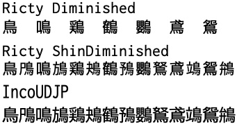

# RictyShinDiminished

プログラミングフォント
**Ricty ShinDiminished**（リクティ・シン・ディミニッシュト：漢字拡張版）
**Ligty ShinDiminished**（リグティ・シン・ディミニッシュト：リガチャ対応漢字拡張版）

[rictyfonts.github.io](https://rictyfonts.github.io/) さんの Ricty、Ricty Diminished の非公式の派生版です。

最新版の Inconsolata を用いて生成した Ricty Diminished を JIS 第 4 水準漢字まで拡張しました。
[Inconsolata](https://github.com/googlefonts/Inconsolata)(3.000) と [Circle M+ 1m](https://itouhiro.github.io/mixfont-mplus-ipa/mplus/)(1.063a.20200415) に加えて [Mgen+](http://jikasei.me/font/mgenplus/)(1.059.20150602) を合成しています。

説明と表示サンプルの原本: [写真集・資料集のフォント紹介](https://www.structure.kais.kyoto-u.ac.jp/lab/photo.html#ShinDiminished) ／ [資料ダウンロード](https://www.structure.kais.kyoto-u.ac.jp/lab/materials.html)



※問題があれば対応しますので [Issues](https://github.com/kymizutani/RictyShinDiminished/issues) までお知らせください。バッククォート（`）の位置がずれるなどの不具合は生じません。

## 収録ファイル

- `fonts/RictyShinDiminished/` — Ricty ShinDiminished と Ricty ShinDiminished Discord（各 8 書体: Regular / Bold / Oblique / BoldOblique）
- `fonts/LigtyShinDiminished/` — Ligty ShinDiminished と Ligty ShinDiminished Discord（各 8 書体）。Ligconsolata を用いたリガチャ対応版です。
- `scripts/` — 生成スクリプト
- `LICENSE.txt` — SIL Open Font License 1.1

フォントは [rictyfonts.github.io](https://rictyfonts.github.io/) の生成スクリプトをほぼそのまま用いて組み合わせています。
同梱の `scripts/` がそのスクリプトで、実行するには FontForge と、入力となる Inconsolata（Ligty は Ligconsolata）、Circle M+ 1m、Mgen+ が必要です。

```sh
./ricty_shindim_generator.sh auto
```

## 版

フォントのバージョンは **G21.230228** のまま変更していません。
リリースタグ `LASB-230228` に、研究室で配布していた zip をそのまま添付しています。

- `RictyShinDiminished-LASB-230228.zip`
- `LigtyShinDiminished-LASB-230228.zip`

## 更新履歴（研究室ページの記録）

- 2023.02.28 フォント名の変更、リガチャ対応版を追加
  ※フォント名の空白が入る位置も変更しましたのでご注意ください。重ね書きされませんので古いバージョンは手動で消してください。
- 2023.02.24 生成スクリプトを改良、統合
- 2023.02.22 最新版の Inconsolata, Circle M+, Mgen+ を用いて生成、公表

## ライセンスとコピーライト

フォントは SIL Open Font License 1.1 で配布されます（全文は [LICENSE.txt](LICENSE.txt)）。
生成スクリプト（`scripts/`）は、スクリプト冒頭に全文がある 2 条項の BSD ライセンスです。

フォントに含まれる著作権表示:

```
Copyright (c) 2011-2017 Yasunori Yusa (Ricty)
Copyright (c) 2006 The Inconsolata Project Authors (Inconsolata)
Copyright (c) 2002-2019 M+ FONTS PROJECT (M+)
Copyright (c) 2020 itouhiro (Circle M+)
Copyright (c) 2014, 2015 Adobe Systems Incorporated (Source Han Sans, with Reserved Font Name 'Source')
Copyright (c) 2015 JIKASEI FONT KOUBOU (Mgen+)
Copyright (c) 2023 Laboratory of Applied Structural Biology
```

生成スクリプトの著作権表示:

```
Copyright (c) 2011-2017 Yasunori Yusa
Copyright (c) 2023 Laboratory of Applied Structural Biology
```

元になったフォント:

| フォント | 作者 | ライセンス |
| --- | --- | --- |
| [Ricty / Ricty Diminished](https://rictyfonts.github.io/) | Yasunori Yusa | SIL OFL 1.1 |
| [Inconsolata](https://github.com/googlefonts/Inconsolata)（Ligty は [Ligconsolata](https://github.com/googlefonts/Inconsolata)） | The Inconsolata Project Authors | SIL OFL 1.1 |
| [Circle M+ 1m](https://itouhiro.github.io/mixfont-mplus-ipa/mplus/) | itouhiro ／ M+ FONTS PROJECT | SIL OFL 1.1 |
| [Mgen+](http://jikasei.me/font/mgenplus/) | JIKASEI FONT KOUBOU | SIL OFL 1.1 |
